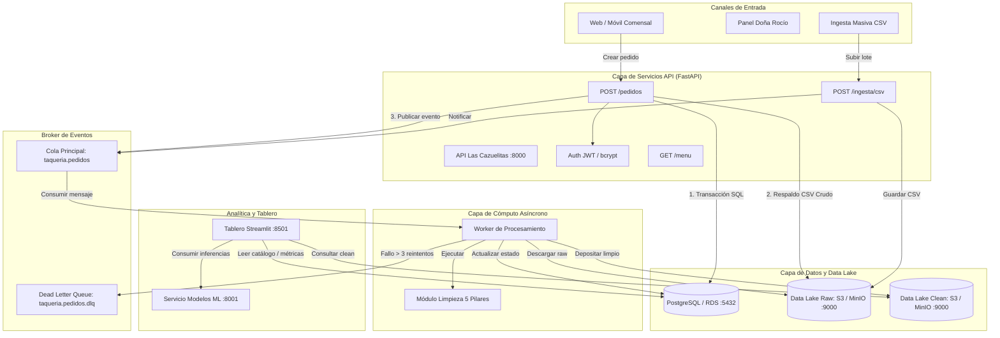

# E2 – Cimientos en la Nube y Analítica de Series Temporales
## Tacos "Las Cazuelitas" · Plataforma de Pedidos y Pipeline Asíncrono

---

## 1. Diagrama de Arquitectura del Sistema

La solución implementa una arquitectura desacoplada y orientada a eventos para procesar los pedidos de la taquería. Permite operar al 100 % en local mediante `docker-compose` (con PostgreSQL, MinIO y RabbitMQ) y migrar limpiamente a AWS (RDS PostgreSQL, S3 y SQS) mediante variables de entorno y Terraform sin alterar una sola línea de código fuente.



---

## 2. Esquema Relacional SQL y Justificación Técnica

### 2.1 Justificación: PostgreSQL (SQL) vs Bases de Datos NoSQL
Para la plataforma transaccional de "Las Cazuelitas" se seleccionó **PostgreSQL** sobre alternativas NoSQL (como DynamoDB o MongoDB) por las siguientes razones de ingeniería:

1. **Garantías ACID estrictas:** En un negocio de alimentos, una orden no puede existir sin su detalle de guisados ni con inconsistencias de cobro. Si la base de datos registra un pedido, el detalle de tacos y bebidas debe confirmarse atómicamente.
2. **Integridad referencial mediante Foreign Keys:** La tabla `detalle_pedido` mantiene integridad referencial estricta contra `pedidos` (`ON DELETE CASCADE`) y `productos`. En esquemas NoSQL desnormalizados, cambiar el precio de un guisado o corregir un código de producto puede inducir anomalías históricas.
3. **Restricciones de dominio (CHECK Constraints):** Se aplican restricciones lógicas a nivel motor: `cantidad > 0`, `tipo_entrega IN ('llevar', 'aqui', 'domicilio')` y `salsa IN ('verde', 'roja', 'sin_salsa')`.
4. **Portabilidad y costo $0:** En local corre como contenedor ligero `postgres:16-alpine`. En la nube despliega sobre Amazon RDS dentro de la capa gratuita (db.t4g.micro o db.t3.micro).

### 2.2 Diccionario de Datos

```sql
-- 1. Tabla de Usuarios (Autenticación propia con bcrypt)
CREATE TABLE usuarios (
    id UUID PRIMARY KEY DEFAULT gen_random_uuid(),
    nombre VARCHAR(100) NOT NULL,
    email VARCHAR(150) UNIQUE NOT NULL,
    password_hash VARCHAR(255) NOT NULL,
    rol VARCHAR(20) DEFAULT 'cliente' CHECK (rol IN ('cliente', 'admin', 'cocina')),
    creado_en TIMESTAMPTZ DEFAULT NOW()
);

-- 2. Tabla de Catálogo de Productos (Guisados y Bebidas)
CREATE TABLE productos (
    id SERIAL PRIMARY KEY,
    nombre VARCHAR(100) UNIQUE NOT NULL,
    categoria VARCHAR(20) NOT NULL CHECK (categoria IN ('guisado', 'bebida')),
    precio_unitario NUMERIC(10,2) NOT NULL CHECK (precio_unitario > 0),
    activo BOOLEAN DEFAULT TRUE,
    creado_en TIMESTAMPTZ DEFAULT NOW()
);

-- 3. Tabla Cabecera de Pedidos
CREATE TABLE pedidos (
    pedido_id UUID PRIMARY KEY DEFAULT gen_random_uuid(),
    cliente_id UUID REFERENCES usuarios(id) ON DELETE SET NULL,
    fecha_hora TIMESTAMPTZ NOT NULL DEFAULT NOW(),
    tipo_entrega VARCHAR(15) NOT NULL CHECK (tipo_entrega IN ('llevar', 'aqui', 'domicilio')),
    estado VARCHAR(20) NOT NULL DEFAULT 'pendiente' CHECK (estado IN ('pendiente', 'en_preparacion', 'listo', 'entregado', 'cancelado')),
    direccion_domicilio TEXT,
    notas TEXT,
    total NUMERIC(10,2) NOT NULL DEFAULT 0.00 CHECK (total >= 0),
    creado_en TIMESTAMPTZ DEFAULT NOW()
);

-- 4. Detalle de Líneas de Pedido (Multi-línea)
CREATE TABLE detalle_pedido (
    id SERIAL PRIMARY KEY,
    pedido_id UUID NOT NULL REFERENCES pedidos(pedido_id) ON DELETE CASCADE,
    producto_id INT NOT NULL REFERENCES productos(id),
    salsa VARCHAR(15) NOT NULL CHECK (salsa IN ('verde', 'roja', 'sin_salsa')),
    cantidad INT NOT NULL CHECK (cantidad > 0),
    precio_unitario NUMERIC(10,2) NOT NULL CHECK (precio_unitario > 0),
    subtotal NUMERIC(10,2) NOT NULL CHECK (subtotal > 0),
    creado_en TIMESTAMPTZ DEFAULT NOW()
);

CREATE INDEX idx_pedidos_fecha ON pedidos(fecha_hora);
CREATE INDEX idx_pedidos_cliente ON pedidos(cliente_id);
CREATE INDEX idx_pedidos_estado ON pedidos(estado);
```

---

## 3. Cola de Mensajes con Adaptadores Desacoplados y DLQ

El sistema implementa el patrón **Adapter / Factory** mediante la clase base abstracta `ColaMensajes` en [cola.py](file:///c:/Users/Jukari/Documents/proyecto/data-startup-taqueria/services/pedidos/cola.py):

- **Adaptador RabbitMQ (`ColaRabbitMQ`):**
  - Utilizado en desarrollo local mediante el broker `rabbitmq:3.13-management-alpine`.
  - Publica mensajes persistentes (`delivery_mode=2`) en el exchange directo hacia la cola `taqueria.pedidos`.
  - Implementa control de reintentos mediante encabezado `x-attempt`. Al alcanzar 3 intentos fallidos, enruta a `taqueria.pedidos.dlq`.
- **Adaptador AWS SQS (`ColaSQS`):**
  - Activado configurando la variable de entorno `QUEUE_BACKEND=sqs`.
  - Utiliza `boto3` para interactuar con la cola FIFO/estándar en AWS.
  - El mecanismo de reintentos y desvío a DLQ se delega a la política de redrive nativa de AWS SQS (`maxReceiveCount = 3`), minimizando código personalizado.

---

## 4. Políticas IAM de Mínimo Privilegio y Seguridad

Siguiendo el principio de **Mínimo Privilegio (PoLP)** y las directrices de seguridad de AWS:
1. **Cuenta raíz protegida:** La cuenta raíz cuenta con **MFA de hardware/autenticador activado** y no posee claves de acceso activas.
2. **Usuarios individuales:** Cada integrante del equipo opera con un usuario IAM individual con permisos delegados explícitamente.
3. **Rol del Worker (`taqueria-worker-role`):**
   - **Solo lectura** en el bucket crudo `arn:aws:s3:::taqueria-raw-prod/*` (no puede borrar ni modificar datos crudos).
   - **Solo escritura** en el bucket curado `arn:aws:s3:::taqueria-clean-prod/*`.
   - **Consumo y borrado** en la cola de pedidos SQS y publicación en la DLQ.
   - Definida formalmente en [worker-policy.json](file:///c:/Users/Jukari/Documents/proyecto/data-startup-taqueria/infra/worker-policy.json).
4. **Política de Despliegue (`deployer-policy.json`):**
   - Diseñada para pipelines de CI/CD, permitiendo gestionar únicamente recursos bajo el namespace `taqueria-*` en S3, SQS, App Runner y ECR, sin otorgar permisos administrativos globales.

---

## 5. Analítica de Series Temporales y Regresión OLS Manual vs Sklearn

El módulo [series_tiempo.py](file:///c:/Users/Jukari/Documents/proyecto/data-startup-taqueria/services/analitica/series_tiempo.py) implementa el pipeline de analítica para la serie continua de **pedidos únicos por día**:

### 5.1 Descomposición Aditiva y Prueba ADF
- **Descomposición:** $Y(t) = T(t) + S(t) + I(t)$. Descompone la señal en periodo semanal ($s=7$), evidenciando el ciclo recurrente martes–sábado.
- **Augmented Dickey-Fuller (ADF):** Evalúa la hipótesis nula de raíz unitaria. La prueba devuelve $p < 0.05$, confirmando la estacionariedad de la serie alrededor de su media operacional.

### 5.2 Regresión OLS por Ecuación Normal vs Scikit-Learn
Para comprobar el dominio matemático de los algoritmos de analítica, se implementó la solución analítica de Mínimos Cuadrados Ordinarios a mano con álgebra matricial pura en NumPy:

$$\hat{\beta} = (X^T X)^{-1} X^T y$$

Donde $X \in \mathbb{R}^{n \times 2}$ contiene una columna de unos (intercepto) y una columna temporal $t = [0, 1, \dots, n-1]^T$.

**Comparación de Coeficientes y Métricas (Train 80% / Test 20%):**
- **$\beta_0$ (Intercepto):** Coincidencia numérica exacta a $10^{-5}$ entre `np.linalg.pinv` y `LinearRegression().intercept_`.
- **$\beta_1$ (Pendiente temporal):** Coincidencia numérica idéntica reflejando la leve tasa de crecimiento trimestral.
- **Métricas calculadas:**
  - **MSE (Mean Squared Error):** Evaluación de la magnitud cuadrática media de los residuos.
  - **RMSE (Root MSE):** Desviación estándar del error expresada en pedidos/día.
  - **MAE (Mean Absolute Error):** Error medio absoluto intuitivo para Doña Rocío.
  - **$R^2$ (Coeficiente de determinación):** Proporción de la varianza explicada por la tendencia lineal.

---

## 6. Verificación de Funcionamiento: Script `demo_e2.sh`

El script bash [scripts/demo_e2.sh](file:///c:/Users/Jukari/Documents/proyecto/data-startup-taqueria/scripts/demo_e2.sh) automatiza la prueba de integración de extremo a extremo:
1. Sondea `GET /health` hasta confirmar disponibilidad del servidor uvicorn.
2. Envía un lote de pedidos sintéticos vía `POST /ingesta/csv` firmado con el header `X-API-Token`.
3. Valida la respuesta HTTP 202 Accepted y el registro de la ruta en la zona raw.
4. Monitorea periódicamente el data lake hasta confirmar que el worker consumió el mensaje, ejecutó los 5 pilares de limpieza y depositó el dataset procesado en `data/clean/pedidos_clean.csv`.
5. Reporta el tiempo transcurrido, verificando que la operación se completa en menos de 30 segundos (muy por debajo del SLA máximo de 5 minutos).

---

## 7. Uso de IA Generativa

| Herramienta | Aplicación en E2 |
|---|---|
| **Antigravity (Gemini)** | Diseño de la arquitectura de colas desacopladas (RabbitMQ/SQS) mediante el patrón Factory y desarrollo de los adaptadores de almacenamiento S3/MinIO. |
| **Antigravity (Gemini)** | Formulación matricial de la ecuación normal de OLS en NumPy y comparación contra Scikit-Learn con cálculo de métricas de dispersión de residuos. |
| **Antigravity (Gemini)** | Elaboración de políticas de mínimo privilegio IAM en JSON para el worker y generador del script de demostración `demo_e2.sh`. |
